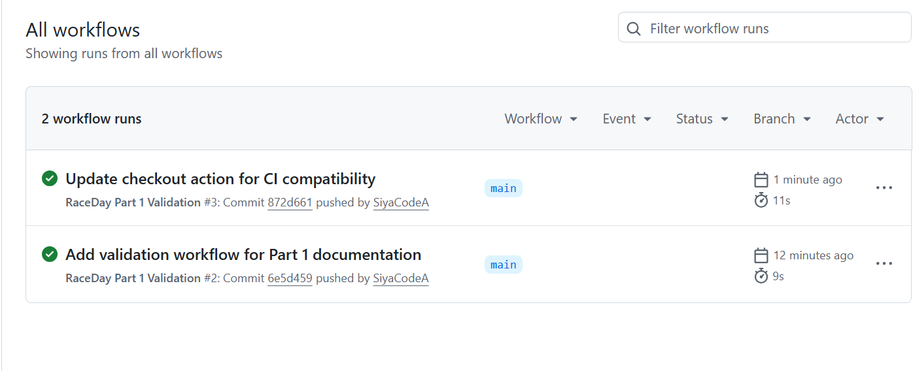

# RaceDay

## Project Overview

RaceDay is a web-based race event management system designed for the South African road running, walking and cycling community.

The system supports two main user roles: **Organisers** and **Participants**. Organisers can create and manage race events, categories and participant results, while Participants can browse available events, enter races, view their entries and track their results.

Part One of the project established the planning and database foundation of the RaceDay system, including the Entity Relationship Diagram (ERD), API endpoint plan and SQL database script. Part Two builds on this foundation by implementing the REST API using ASP.NET Core, integrating SQL Server, implementing authentication and role-based authorization, and testing the application through automated unit tests and GitHub Actions. Part Three will focus on developing the user-facing MVC application.

---

## Features

### Organiser Features

* Create race events
* Update race events
* Delete race events
* Manage event categories
* View entries for their events
* Capture and manage participant results

### Participant Features

* Create and manage an account
* Browse available race events
* View event information
* Enter race events
* View personal entries
* View personal race results and performance history

### Part One Features

* Logical database design
* Entity Relationship Diagram
* REST API endpoint planning
* SQL Server database schema
* Seed/sample data
* Database constraints and relationships
* GitHub version control
* GitHub Actions CI validation

---

## Technology Stack

| Technology                          | Purpose                                           |
| ----------------------------------- | ------------------------------------------------- |
| C#                                  | Application development                           |
| .NET / ASP.NET Core                 | Backend and REST API development                  |
| SQL Server                          | Relational database                               |
| SQL Server Management Studio (SSMS) | Database development and testing                  |
| REST API                            | Communication between application components      |
| GitHub                              | Source control and project repository             |
| GitHub Actions                      | Continuous integration and automated validation   |
| MVC                                 | Web application architecture in Part Three        |
| Docker                              | Application containerisation in later development |
| Microsoft Azure                     | Cloud services in later development               |

| Entity Framework Core | Database access and object-relational mapping |
| Swagger / OpenAPI | API documentation and endpoint testing |
| Visual Studio | Application development and debugging |
| .NET testing tools | Automated unit testing |
---

## Repository Structure

RaceDay-System/
│
├── .github/
│   └── workflows/
│
├── Authentication/
├── Controllers/
├── DTOs/
├── Models/
├── Properties/
├── RaceDay.Tests/
│
├── docs/
│   ├── API/
│   ├── CI/
│   ├── ERD/
│   ├── Evidence/
│   │   ├── Authentication/
│   │   ├── Swagger/
│   │   └── Testing-and-Workflows/
│   └── SQL/
│
├── workflows/
│
├── Program.cs
├── RaceDay.API.csproj
├── RaceDay.API.http
├── RaceDay.API.slnx
├── WeatherForecast.cs
├── appsettings.json
├── appsettings.Development.json
└── README.md

The `docs` directory contains the Part One planning documents, database artefacts and supporting evidence. The `Authentication`, `Controllers`, `DTOs` and `Models` folders organise the Part Two API implementation. The `RaceDay.Tests` folder contains the automated test project.

The `.github/workflows` directory contains GitHub Actions workflow definitions. The repository also contains a `workflows` directory. The tree provides a high-level overview of the project structure.

---

## Part One Documentation

### ERD

The Entity Relationship Diagram is available at:

[**RaceDay ERD**](docs/ERD/RaceDay-ERD.png)

The ERD represents the RaceDay database entities, attributes, primary keys, foreign keys, relationships and cardinalities.

### API Endpoint Plan

The completed API endpoint plan is available in PDF format:

[**API Endpoint Plan – PDF**](docs/API/API_Endpoint_Plan.pdf)

An editable Excel version is also included:

[**API Endpoint Plan – Excel**](docs/API/API_Endpoint_Plan.xlsx)

The plan defines the REST API endpoints required by the system, including HTTP methods, routes, descriptions, required roles, parameters, request bodies, expected responses and failure responses.

The planned API areas include:

* Authentication
* Accounts
* Events
* Categories
* Entries
* Results
* Routes
* Weather

### SQL Database Script

The database script is available at:

[**RaceDay Database SQL Script**](docs/SQL/RaceDayDatabase.sql)

The script contains the SQL required to create the RaceDay database structure, define its constraints and relationships, and populate it with sample data.

---

## Reproducing the Part One Setup

Another developer should be able to reproduce the Part One database and review the planning artefacts using the files contained in this repository.

### Requirements

Before starting, install or have access to:

* Git
* GitHub account
* SQL Server
* SQL Server Management Studio (SSMS)

### Step 1 – Clone the Repository

Clone the repository from GitHub:

```bash
git clone https://github.com/SiyaCodeA/RaceDay-System.git
```

Navigate into the project directory:

```bash
cd RaceDay
```

### Step 2 – Verify the Repository Contents

Confirm that the following Part One artefacts are present:

```text
docs/
├── API/
│   ├── API_Endpoint_Plan.xlsx
│   └── API_Endpoint_Plan.pdf
├── CI/
│   └── Part1-CI-Success.png
├── ERD/
│   └── RaceDay-ERD.png
└── SQL/
    └── RaceDayDatabase.sql
```

The GitHub Actions workflow should also be present at:

```text
.github/
└── workflows/
    └── part1-validation.yml
```

### Step 3 – Review the ERD

Open:

```text
docs/ERD/RaceDay-ERD.png
```

Use the ERD to understand the database entities, attributes and relationships before executing the SQL script.

### Step 4 – Set Up the Database

Open **SQL Server Management Studio**.

1. Connect to the required SQL Server instance.
2. Open:

```text
docs/SQL/RaceDayDatabase.sql
```

3. Review the script.
4. Execute the complete script.
5. Confirm that the RaceDay database and required tables have been created.
6. Confirm that the supplied seed/sample data has been inserted successfully.

### Step 5 – Verify the Database

After execution, verify that:

* All expected tables exist.
* Primary keys have been created.
* Foreign key relationships have been created.
* Required constraints are present.
* Seed data has been inserted.
* The resulting database structure corresponds with the final ERD.

### Step 6 – Review the API Plan

Open the formal PDF:

```text
docs/API/API_Endpoint_Plan.pdf
```

The Excel version is available for reference or further editing:

```text
docs/API/API_Endpoint_Plan.xlsx
```

Review the planned endpoints and confirm that they correspond with the system requirements and database design.

This completes the reproducible **Part One setup**.

---

## SQL Instructions

The SQL script is designed to be executed on a clean SQL Server instance or test database environment.

The recommended process is:

1. Open SQL Server Management Studio.
2. Connect to SQL Server.
3. Open `docs/SQL/RaceDayDatabase.sql`.
4. Execute the complete script.
5. Check for execution errors.
6. Refresh the database list and verify that the RaceDay database has been created.
7. Inspect the tables and relationships.
8. Query the tables to confirm that the seed data has been inserted.

The SQL implementation should remain consistent with the final ERD.

---

## CI/CD Evidence

GitHub Actions is used to validate the required Part One documentation files.

The validation workflow checks that the required ERD, API Endpoint Plan, SQL database script and README files are present in the repository.

### Successful CI Validation



The successful workflow execution provides evidence that the Part One repository validation completed successfully.

---

## Presentation

The Part One presentation video will demonstrate:

* The RaceDay system planning
* ERD design decisions
* API endpoint plan choices
* SQL database design
* Execution of the SQL script in SQL Server Management Studio
* Part One project structure and validation


**YouTube Link:** [RaceDay Part 1 Presentation](https://youtu.be/Jz9zT-6gj-Q)

### Part Two – REST API Development and Testing

The Part Two presentation demonstrates the implementation and testing of the RaceDay REST API.

The presentation covers:

- The ASP.NET Core API project structure in Visual Studio.
- Swagger / OpenAPI and API endpoint testing.
- SQL Server database integration.
- Authentication and role-based authorization for Organisers and Participants.
- Testing a restricted operation and verifying the expected authorization response.
- Automated unit testing, including the six passing tests.
- GitHub Actions workflows and successful validation results.
- The supporting evidence available in the repository.

**Part Two YouTube Link:** [RaceDay Part 2 Presentation](https://youtu.be/3WTatosfY_E)

---
## Part Three – MVC Application and Cloud Integration

Part Three extends the RaceDay REST API into a user-facing ASP.NET Core MVC web application. The MVC application communicates with the REST API through HTTP requests, while the API manages database operations.

### MVC Application Features

**Authentication and Navigation**
- Login functionality for Organisers and Participants.
- Role-based access and navigation.
- Separate dashboards for each user role.

**Organiser Functionality**
- Create, view, update and delete race events.
- Manage event categories.
- View and manage participant entries.
- Record and manage participant results.

**Participant Functionality**
- Browse available race events.
- View event details and categories.
- Enter events.
- View personal entries and entry statuses.
- View recorded results and performance history.

### Cloud Storage

Microsoft Azure Blob Storage is configured to store event banner images. The application uses an Azure Storage Account and an `event-banners` container, with the API responsible for handling image uploads.


### Docker and Continuous Integration

The RaceDay application includes separate Dockerfiles for the ASP.NET Core Web API and MVC applications.

**Docker Images**

The API and MVC Docker images can be built from the repository root:

```bash
docker build -f RaceDay.API/Dockerfile -t raceday-api:latest .
docker build -f RaceDay.MVC/Dockerfile -t raceday-mvc:latest .
```

**Running the Containers**

Create a Docker network so that the MVC container can communicate with the API container:

```bash
docker network create raceday-network
```

Start the API container:

```bash
docker run -d \
  --name raceday-api \
  --network raceday-network \
  -p 8081:8080 \
  -e ASPNETCORE_ENVIRONMENT=Development \
  -e ConnectionStrings__DefaultConnection="Server=<SQL_SERVER_HOST>,<SQL_PORT>;Database=RaceDayDB;User Id=<SQL_USERNAME>;Password=<SQL_PASSWORD>;TrustServerCertificate=True;Encrypt=False;" \
  -e BlobStorage__ConnectionString="<AZURE_STORAGE_CONNECTION_STRING>" \
  -e BlobStorage__ContainerName="event-banners" \
  raceday-api:latest
```

Start the MVC container:

```bash
docker run -d \
  --name raceday-mvc \
  --network raceday-network \
  -p 8082:8080 \
  -e ApiSettings__BaseUrl=http://raceday-api:8080/ \
  raceday-mvc:latest
```

**Accessing the Applications**

After both containers have started:

- MVC application: http://localhost:8082
- API Swagger documentation: http://localhost:8081/swagger

**Database and Cloud Configuration**

The API container requires a SQL Server connection string that can reach the database from inside Docker. Replace the SQL Server placeholders in the command with the appropriate connection details. The SQL Server must be configured to accept the chosen network connection.

Azure Blob Storage settings are supplied through environment variables. Replace the Azure connection-string placeholder with a valid storage connection string when cloud image uploads are required.

Do not commit database passwords, Azure connection strings or other sensitive credentials to the repository.

**Container Verification**

Use the following command to check the running containers:

```bash
docker ps
```

To view application logs:

```bash
docker logs raceday-api
docker logs raceday-mvc
```

To stop the containers:

```bash
docker stop raceday-mvc raceday-api
```

**GitHub Actions**

The GitHub Actions workflow at `.github/workflows/docker-build.yml` automatically builds both Docker images and performs runtime checks on the API Swagger page and MVC login page.

The successful workflow confirms that both containers can start and respond to HTTP requests. It does not perform a full SQL Server database integration test.


### Technologies Used

- C#
- ASP.NET Core MVC
- ASP.NET Core Web API
- Entity Framework Core
- SQL Server
- Microsoft Azure Blob Storage
- Docker
- GitHub and GitHub Actions
- Visual Studio

### Part Three Setup and Configuration

The MVC application communicates with the RaceDay API. Both projects must be configured and running for local application functionality.

Azure Blob Storage requires a valid storage connection string and container configuration. Sensitive credentials must be configured using development secrets or environment variables and must never be committed to GitHub.

GitHub Actions builds both Docker images and verifies that the API and MVC containers start and respond successfully. A separate database integration test is not included in this workflow.
--
